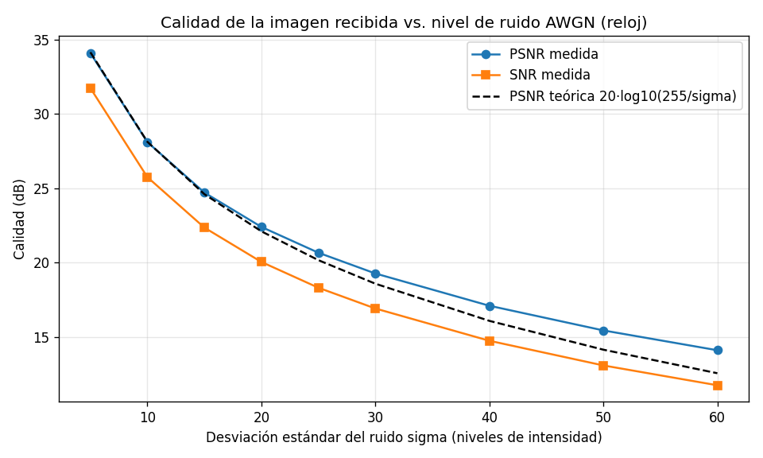
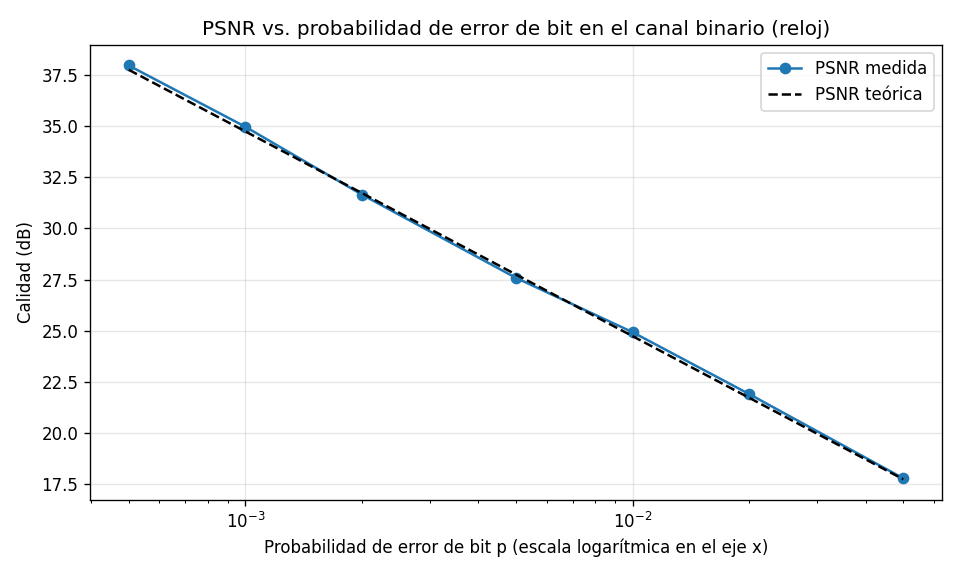

# Transmisión y recuperación de imágenes a través de un canal con ruido

Proyecto semestral de **Teoría de Señales** — Segunda entrega.

**Integrantes**
- Nombre Apellido 1
- Nombre Apellido 2
- Nombre Apellido 3

## 1. Descripción

Una imagen digital es una señal bidimensional discreta. Este proyecto estudia qué le ocurre a
esa señal cuando se transmite por un canal con ruido y cómo se puede medir y, más adelante,
recuperar la información original.

El sistema carga **cualquier imagen** (color o escala de grises, cualquier tamaño y formato),
la representa numéricamente, la envía por un canal ruidoso **simulado** y compara la imagen
recibida con la original mediante gráficas y métricas objetivas.

## 2. Estado actual

**Ya funciona**
- [x] Carga de cualquier imagen mediante un selector de archivos o por línea de comandos
- [x] Representación numérica y caracterización de la imagen (muestras, bits, mínimo, máximo, media, potencia)
- [x] Tres modelos de canal: ruido gaussiano (AWGN), sal y pimienta y canal binario simétrico
- [x] Comparación original vs. recibida: imágenes, perfil de una fila (señal 1D), histograma
- [x] Métricas MSE, PSNR y SNR, verificadas contra valores teóricos
- [x] Resultados reproducibles con semilla fija

**Falta por desarrollar**
- [ ] Análisis frecuencial (transformada de Fourier) cuando se vea en clase
- [ ] Etapa de recuperación de la imagen (filtrado y/o corrección de errores)
- [ ] Evaluación de la recuperación con las métricas ya definidas
- [ ] Experimentos con más imágenes y niveles de ruido

## 3. Datos y recursos

| Recurso | Descripción | Fuente |
|---|---|---|
| `data/cameraman.png` | Imagen en grises, 512 x 512, 8 bits | Imagen `camera` de scikit-image (CC0, fotografía de Lav Varshney) |
| `data/astronauta.png` | Imagen a color RGB, 512 x 512 | Imagen `astronaut` de scikit-image (NASA, dominio público) |
| USC-SIPI Image Database | Banco de imágenes estándar para procesamiento de imágenes | Weber (2018), https://sipi.usc.edu/database/ |

La base USC-SIPI **no** se incluye completa en el repositorio. Las instrucciones para descargar
imágenes adicionales (por ejemplo Peppers `4.2.07`, Mandrill `4.2.03` o `boat.512`) están en
[`data/README.md`](data/README.md).

El ruido **no** proviene de una base de datos: se genera por simulación y sus parámetros se
documentan en la sección 7.

## 4. Cómo ejecutar

**Requisitos:** Python 3.9 o superior (probado con 3.12).

```bash
git clone <URL-del-repositorio>
cd <carpeta-del-repositorio>
pip install -r requirements.txt     # numpy, Pillow, matplotlib
```

**Ejecutar el sistema con una imagen elegida:**
```bash
python main.py                      # abre una ventana para elegir la imagen
python main.py --image data/cameraman.png --gray --channel awgn --param 25 --seed 42
python main.py --image data/astronauta.png --channel salt_pepper --param 0.05
python main.py --image data/cameraman.png --gray --channel bsc --param 0.01
```

| Canal (`--channel`) | Parámetro (`--param`) |
|---|---|
| `awgn` | Desviación estándar del ruido, sigma (0-255) |
| `salt_pepper` | Probabilidad de que un píxel sea corrompido |
| `bsc` | Probabilidad de que un bit se invierta |

Otras opciones: `--gray` (escala de grises), `--seed` (repetir resultados), `--fila` (fila para
el perfil), `--prueba` (imagen sintética), `--no-show` (no abrir ventanas). Las figuras se
guardan en `results/`.

**Regenerar los resultados de este README:**
```bash
python generar_resultados.py
```

En Linux, el selector de archivos puede requerir `sudo apt install python3-tk`. Si no está
disponible, el programa pide la ruta por consola.

## 5. Estructura del repositorio

```
main.py                  programa principal
generar_resultados.py    genera las figuras y tablas de results/
src/image_io.py          lectura, guardado, selector de archivos y comparación visual
src/channel.py           modelos del canal con ruido
src/analysis.py          caracterización de la señal y estadísticas del error
src/metrics.py           MSE, PSNR, SNR, tasa de error de bit
src/plots.py             perfil de fila, histograma, curvas de calidad
data/                    imágenes de muestra y fuentes
results/                 figuras y métricas generadas
docs/                    documentación del modelo del canal
notebooks/               (reservado para notebooks)
```

## 6. Conceptos de Teoría de Señales utilizados

- **Señal discreta bidimensional:** la imagen se trata como `f[m, n]`.
- **Muestreo espacial y cuantización:** cada píxel es una muestra; cada muestra usa 8 bits (256 niveles).
- **Señal 1D a partir de una fila:** el perfil de intensidad de una fila se analiza como una señal discreta.
- **Caracterización de señales:** mínimo, máximo, media (nivel DC), desviación estándar y potencia media.
- **Ruido como proceso aleatorio:** ruido gaussiano de media cero y varianza sigma², ruido impulsivo y errores de bit.
- **Relación señal a ruido:** SNR y PSNR expresadas en decibeles, y MSE como medida del error.
- **Por incorporar:** análisis en frecuencia, convolución y filtrado (a medida que se vean en clase).

El detalle matemático del modelo está en [`docs/modelo_del_canal.md`](docs/modelo_del_canal.md).

## 7. Resultados actuales

Todos los resultados usan semilla `42` y se pueden reproducir con `python generar_resultados.py`.

| Imagen | Canal | Parámetro | MSE | PSNR (dB) | SNR (dB) |
|---|---|---|---|---|---|
| cameraman (grises) | AWGN | sigma = 25 | 569.06 | 20.58 | 15.89 |
| cameraman (grises) | Sal y pimienta | prob = 0.05 | 1067.49 | 17.85 | 13.16 |
| cameraman (grises) | Binario simétrico | p = 0.01 | 216.51 | 24.78 | 20.09 |
| astronauta (color) | AWGN | sigma = 25 | 533.74 | 20.86 | 15.68 |

La tabla completa, con estadísticas del error, está en [`results/metricas.csv`](results/metricas.csv).

**Caracterización de la imagen cameraman (original):** 512 x 512 = 262 144 muestras, 8 bits por
muestra (2 097 152 bits), mínimo 0, máximo 255, media 129.06 y desviación estándar 73.64.

### 7.1 Imagen original vs. imagen con ruido


El ruido gaussiano afecta a casi todos los píxeles (98.34 % de las muestras cambia) con
desviaciones pequeñas, y se percibe como un "grano" uniforme. La imagen diferencia casi no
muestra estructura, lo que indica que el ruido es independiente del contenido de la imagen.


El ruido sal y pimienta altera pocos píxeles (4.97 %), pero con cambios muy grandes (puntos
blancos y negros aislados). Por eso, aunque toca menos píxeles, su MSE (1067.49) es mayor que
el del AWGN.


En el canal binario, solo el 7.68 % de las muestras cambia, pero el efecto visual depende de
qué bit se invirtió: los errores en bits de mayor peso producen puntos muy claros u oscuros,
mientras que los de bits menos significativos casi no se notan.


En una imagen a color el ruido se aplica a cada canal (rojo, verde y azul) por separado,
y por eso aparece como granos de color.

### 7.2 La imagen vista como señal 1D: perfil de una fila


Al tomar la fila central (fila 256) la imagen se convierte en una señal de intensidad en función
de la posición horizontal. La señal original es relativamente suave: en la zona oscura la
intensidad ronda valores bajos y cerca de la columna 280 hay un salto brusco (un borde) hacia
intensidades altas. La señal recibida oscila de forma aleatoria alrededor de la original: el
ruido se suma muestra a muestra. En la ventana ampliada se observan además varias muestras
recortadas en 0, porque los valores no pueden salir del rango [0, 255].

### 7.3 Histograma de intensidades


El histograma original tiene picos marcados (alrededor de 25, 160 y 205). Con ruido los picos
se ensanchan y se aplanan, porque cada valor se dispersa alrededor de su valor original. Además
aparecen acumulaciones en 0 y 255: son las muestras recortadas. Esto explica por qué la media del
error no es exactamente 0 (0.65) y su desviación (23.85) es algo menor que sigma = 25.

### 7.4 Calidad vs. nivel de ruido



A mayor sigma, menor PSNR y SNR, siguiendo aproximadamente la curva teórica
PSNR = 20·log10(255/sigma). La medida queda ligeramente por encima de la teórica para sigma
grande, por el efecto del recorte a [0, 255].



En el canal binario, la probabilidad de error de bit y el PSNR coinciden con la expresión
teórica MSE = p·(4⁸ − 1)/3. Para p = 0.01 se midió 24.78 dB frente a 24.74 dB teóricos.

### 7.5 Qué se medirá para evaluar la recuperación

Cuando se implemente la recuperación se compararán la imagen original y la recuperada usando
**MSE, PSNR y SNR** (y la tasa de error de bit en el caso del canal binario), y se verificará
si la recuperada es mejor que la recibida sin procesar, es decir, si el PSNR sube.

## 8. Referencias

- Weber, A. G. (2018). *The USC-SIPI Image Database: Version 6* (USC-SIPI Report #432). Signal and Image Processing Institute, University of Southern California. https://sipi.usc.edu/database/
- Gonzalez, R. C., & Woods, R. E. (2018). *Digital Image Processing* (4th ed.). Pearson.
- Shannon, C. E. (1948). A mathematical theory of communication. *The Bell System Technical Journal, 27*(3), 379–423.
- van der Walt, S., Schönberger, J. L., Nunez-Iglesias, J., Boulogne, F., Warner, J. D., Yager, N., Gouillart, E., Yu, T., & the scikit-image contributors (2014). scikit-image: image processing in Python. *PeerJ, 2*, e453.
- [COMPLETAR] Antecedentes del marco teórico (Primera entrega): Chávez, Hoyos Sarmiento y Silva Ávila, *Restauración de imágenes degradadas por ruido y distorsión lineal a través de algoritmos directos*, ESPOL (verificar año y datos de publicación). Agregar aquí los demás antecedentes usados.
